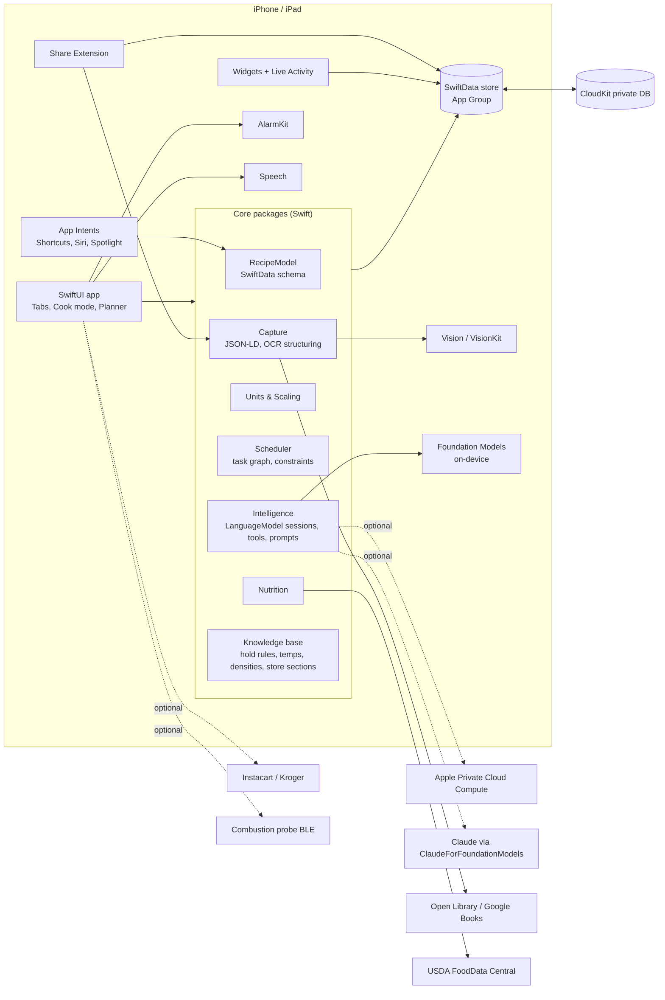

# Recipe Codex — User Flows, App Layout and Architecture

*Oct 17, 2026. This document describes how the app is organized, how the core flows move through it, and how it talks to Apple's systems and outside services. Screen-level design is in [03-UX-Proposals](03-UX-Proposals.md) and [wireframes.html](wireframes.html).*

## 1. Information architecture

### 1.1 Top level

Five tabs on iPhone, matching the HIG preference for a small number of tabs with a dedicated trailing search tab. They sit in the order the work happens: collect recipes, stock the kitchen, plan the dinner, cook it. On iPad the same tabs appear in a top tab bar that converts to a sidebar (`.sidebarAdaptable`), where each tab expands into sections.

| Tab | Purpose | iPad sidebar sections |
|---|---|---|
| **Recipes** | The library, with a view switch between **Recipes** (browse, filter, collections) and **Books** (the cookbook shelf: completeness, sections, index, scanning queue). | Recipes: All, Favorites, Never cooked, Recently cooked, Collections, Smart collections, Tags. Books: Shelf, each book, Scanning queue |
| **Pantry** | Your kitchen as a resource: pantry ingredients, tools, sources (stores you frequent and specialty suppliers), cellar and bar, kitchens, and your profile and settings. | Pantry, Tools, Sources, Cellar & Bar, Kitchens, Profile |
| **Plan** | Events and menus (with pairings), shopping lists, schedules, guests. | Events, Shopping lists, Schedules, Guests |
| **Cook** | Today. The active cook or service session if one is running; otherwise tonight's plan, today's prep tasks, timers, and "what should I make" suggestions. | Today, Active session, Upcoming events |
| **Search** | The one place to find anything (recipes, books, events, ingredients, sources, cook history). | Search |

Books is a view of the library rather than a tab because a cookbook is a way of grouping recipes, not a separate activity; the shelf, book detail and scanning queue are unchanged, they just open from the Recipes tab. The Pantry tab replaces the profile button: what you have on hand (ingredients, tools, wine, suppliers) is consulted while planning and shopping, which makes it a destination. Profile and settings (proficiency, units, voice, intelligence, export) are its last pane.

The top toolbar of every top-level screen is contextual: **Add (+)** when the screen can create something (a recipe or book, a pantry item or source, an event), and a **More (⋯)** menu for screen-level actions (view switch, sort, select, import and export). There is no profile button.

### 1.2 Persistent surfaces

- **Now Cooking accessory.** iPhone only. When a cook or service session is active, a bottom accessory sits above the tab bar (the Music MiniPlayer pattern) showing current step, next timer, and a Next button. Scrolling minimizes the tab bar into it. Tapping expands to full cook mode. On iPad the session lives in its own window instead.
- **Live Activity.** Mirrors the session to the Dynamic Island, Lock Screen, StandBy, Apple Watch Smart Stack and the Mac menu bar.
- **Widgets.** Tonight's plan, next event countdown, running timers, "cook something new" suggestion.
- **Siri and Spotlight.** Recipes, books and events are indexed entities; cook mode actions are App Shortcuts.

### 1.3 Navigation depth

| Path | Depth |
|---|---|
| Recipes → Recipe detail → Cook | 2 |
| Recipes (Books view) → Book detail → Recipe detail | 2 |
| Pantry → pane (Sources, Cellar & Bar, …) → item | 2 |
| Plan → Event → Menu / Shopping / Schedule → item | 3 |
| Cook → Service mode (full screen) | 1 |
| Search → result → detail | 2 |

Capture flows (import, scan, manual entry, book session) are modal sheets or full-screen covers launched from the **Add** menu in the Recipes toolbar, whose items follow the view: Import, Scan page and New recipe in the Recipes view; Add book in the Books view. They never live in the tab hierarchy.

## 2. Core user flows

Each flow lists the steps, the system pieces involved, and where the user can bail out or fix mistakes.

### Flow A — Import from the share sheet

1. In Safari or NYT Cooking, tap Share → Recipe Codex.
2. The Share Extension shows a compact preview: title, image, source, "Save" and "Open in app."
3. Behind the preview: parse JSON-LD (instant). If none, render and extract with the on-device model (2 to 6 seconds, with specific progress text per the HIG Generative AI guidance: "Reading ingredients…").
4. Save writes to the shared App Group store; the main app picks up the change through `HistoryObserver` and syncs via CloudKit.
5. Next time the app opens, a quiet "1 new recipe needs a look" row appears on Cook if the extraction had low confidence.

Fix-up: every imported recipe opens in the same editable structure as a manual one. The source URL and a "Reader tips" placeholder stay attached.

### Flow B — Scan one page

1. Recipes → Add → Scan page.
2. Camera opens (VisionKit document camera). Overlay shows a quality meter: Sharp / Hold still / Clean lens.
3. Capture one or more pages. "Add next page" is one tap because recipes span pages.
4. Processing sheet: "Reading text… Finding ingredients… Finding steps…" (each stage real).
5. **Review, when it is needed.** Review is forced for the first recipe captured from each book, and again whenever a page's layout differs from one already confirmed for that book (two columns, a sidebar of notes, a recipe that spans a spread). Once a layout is confirmed, later scans save straight to the library, and the review screen appears only when confidence is low: OCR confidence under threshold, ingredient lines that did not parse into quantity and item, a step count that does not match the page, or a region the structurer could not assign. The review screen itself: the structured recipe on top, the page image below with colored regions. Tap a region to reassign it (Title, Yield, Ingredients, Step, Headnote, Ignore). On iPad, Apple Pencil lasso does the same. Every scanned recipe keeps a Review action in More, so an auto-accepted scan can be checked later.
6. If a cross-reference was found ("Pasta Dough, page 84"), a card asks: Link to existing recipe / Add to this book's to-scan list / Ignore.
7. Book and page: if the scan was started from a book, both are prefilled; otherwise a "Which book?" field offers recent books or ISBN scan.
8. Save. The page image stays attached and viewable from the recipe forever.

### Flow C — Add a whole cookbook

1. Recipes → Books view → Add book → scan ISBN (or type it, or search by title).
2. Book card appears with cover, title, author, year from Open Library/Google Books. Confirm.
3. "Build the recipe list": scan the table of contents and chapter openers (and the index if useful). The model extracts recipe titles and pages; you correct inline. Result: a punchlist of N recipes, each with a page number.
4. **Scanning session** (full screen, iPad-optimized but works on iPhone): punchlist on the left, camera on the right. The current item is the next uncaptured recipe; captured pages accumulate under it. Tapping a different recipe jumps to it. Page numbers read off the scans keep the list in step automatically.
5. OCR and structuring run in a background queue; the session shows "12 captured, 9 processed, 2 need review."
6. Stop any time. The Books view shows the book as "47 of 112 recipes captured" with a filter for what's missing. Resume later from where you were.
7. Review queue: the first recipe (which confirms the book's layout) and anything flagged low-confidence; swipe through them, fix regions, link sub-recipes, done. Everything else is accepted automatically and marked as such.
8. Sources page: if the book ends with a Sources or Resources page (suppliers for equipment and ingredients), scan it once. Each entry (name, phone, website, what they carry) becomes a Source linked to the book in Pantry → Sources.

### Flow D — Manual entry

Recipes → Add → New recipe. A single scrolling form: title, source (free text or "my own"), yield, times (optional), ingredients (structured rows with a smart parser for "2 cups flour, sifted"), steps (one text field per step, reorderable), notes. Any field may be blank. The first time you cook it, the post-cook flow offers to fill the blanks.

### Flow E — Find and cook one recipe

1. Browse Recipes with filter chips (course, cuisine, time, dietary, cooked state, book) or use Search.
2. Recipe detail: hero image, title, source badge (book + page or site), times (stated and observed), yield with a stepper, tags, the "never cooked" or "cooked 4×, last in Seattle" line, ingredients, steps, collapsed headnote, nutrition estimate, version history, cook log.
3. Adjust servings; ingredient quantities rescale with friendly rounding.
4. Tap **Cook**. Cook mode opens full screen; the Now Cooking accessory and Live Activity start.
5. Step view: current step large, ingredients for this step highlighted, times tappable to start timers, next step previewed. Advance by tap, swipe, Siri, Action button, or voice phrase.
6. Finish → **Post-cook**: rating, "how did it go" note, photo (offered as new cover), observed time (auto), yield confirmation, where (auto). Thirty seconds, every field optional.

### Flow F — Plan an event

1. Plan → New event: name, date, arrival time, seating time, guest count, guests (from profiles or new), restrictions (merged from profiles), kitchen (home or another), notes.
2. **Menu builder**: course slots (Starter, Main, Sides, Dessert, Drinks, plus custom). Add candidates to a slot from the library (browse/search in a sheet, or drag on iPad). Several candidates per slot are fine until you finalize.
3. As you add: sub-recipes appear automatically under their parent; warnings appear as inline notes, not alerts ("Never cooked," "Three dishes need the oven at different temperatures," "Rosa is gluten-free; the gnocchi contains flour").
4. **Balance panel**: coverage by course, protein/veg/starch, total servings vs guests, complexity load, pre-arrival share of work.
5. Optional **Ask Codex**: a chat sheet where you describe the evening; it proposes a full menu with reasons, pulls only from your library, and lets you swap any item. Every suggestion shows which library recipe it is and why it fits.
6. Set servings per dish (default to guest count), doneness targets for proteins.
7. **Finalize** → generates the shopping list and the workback schedule.

### Flow G — Shop

1. Plan → Event → Shopping list (also reachable from Plan → Shopping lists).
2. List grouped by stop (Whole Foods, Butcher, Fishmonger) and within each by store section. Pantry items you have are hidden under "Have at home (8)"; tap to move one back to the list.
3. Check items off; it syncs to the other device. Long-press an item to see which recipes need it and the per-recipe quantities.
4. Share as text or to Reminders for someone without the app. Optional Instacart link.

### Flow H — Prep across days (the workback schedule)

1. Plan → Event → Schedule. A multi-day timeline ending at seating time. Each task is a card with recipe color, duration, and an icon for active vs passive.
2. The scheduler has already placed tasks: fridge rests and doughs the day before, mise en place the morning of, cleaning blocks before arrival, hot items last.
3. Drag a task to another time or day. Feasible moves snap in; infeasible moves show the reason in place ("Dough needs 24 h in the fridge; latest start is Fri 6 PM").
4. Overload is shown as a density bar per hour against your concurrency limit.
5. "Reserve tasks" section: simple tasks you could hand to a guest.
6. The schedule also appears as a daily checklist on Cook (today's tasks) and as calendar entries if you want them.

### Flow I — Service mode (cooking the event)

1. On the day, Cook shows "Today: Sunday Supper, 8 guests, seating 7:30." Tap **Start service**.
2. Service mode is cook mode across recipes: a **Now** lane (what you're doing), a **Next** lane, a **Watch** lane (passive tasks with timers: oven, resting, chilling), and a status line: "On plan" or "12 min behind seating."
3. Each task opens the relevant recipe step with its ingredients. Done advances. Timers start from highlighted times and run under AlarmKit so they break through Silent.
4. Proactive prompts: "Roast should be near 118°F. Check it." You enter 112 → "About 9 more minutes; I'll ask again at 6:52."
5. Falling behind triggers **Replan**: the scheduler re-runs from now, keeps what's done, and proposes the new order; you accept or edit.
6. Pre-arrival checkpoint: "Guests arrive in 30 min. Kitchen reset block starts now." Post-arrival tasks are the short ones by design.
7. Plating and serving steps appear per course with hold reminders. End of service → **Debrief**: per-dish ratings and notes, event notes, photo, and a "next time" list.

### Flow J — First run (kitchen setup)

Three screens, skippable: your kitchen's tools (checklist with counts for ovens and burners), proficiency (three levels with a sentence each about what changes), and pantry staples (a prefilled checklist to trim). Everything is editable later from the Pantry tab.

## 3. Interaction model

| Context | Primary input | Secondary |
|---|---|---|
| Browsing | Touch; iPad pointer and keyboard; drag and drop recipes into menu slots and schedule | Siri ("show my braises") |
| Capture | Camera; tap regions; Apple Pencil lasso on iPad | Keyboard for corrections |
| Planning | Touch and drag on timeline; keyboard shortcuts on iPad | Chat with Ask Codex |
| Cooking | Standard-size controls (the HIG 44 pt minimum) spaced widely enough to hit with a knuckle, large type, swipe anywhere to advance, Action button, Siri App Shortcuts, in-app voice phrases | Apple Watch Smart Stack glance; probe thermometer |

Hands-free details: Siri phrases ("Next step," "Back," "Start the timer," "How long on the roast," "What's next") map to App Shortcuts with multiple phrasings. The Action button is assigned to "Next step" in Settings on first run via a one-tap deep link. In-app listening (opt-in) uses the on-device Speech framework for a small command set and shows the system microphone indicator.

## 4. System architecture



### 4.1 Package boundaries

| Package | Responsibility | Depends on | Testing |
|---|---|---|---|
| **RecipeModel** | SwiftData models, versioning, migrations, CloudKit rules | Foundation, SwiftData | Schema tests, migration tests |
| **Units** | Quantities as rationals, unit conversion, density table, friendly rounding, scaling warnings | Foundation | Pure unit tests, hundreds of cases |
| **Capture** | JSON-LD parsing, HTML fallback, OCR orchestration, region model, cross-reference detection, book metadata lookup | Vision, VisionKit, Intelligence | Fixture pages and HTML; golden outputs |
| **Intelligence** | `LanguageModel` selection (on-device / PCC / Claude), prompt library, `@Generable` types, tools, chunking, evaluation harness | FoundationModels | Evaluations framework fixtures; deterministic fallbacks |
| **KnowledgeBase** | Hold rules by component type, doneness and food-safety tables, equipment taxonomy, store-section taxonomy, allergen keywords | none | Table tests |
| **Scheduler** | Task graph, constraints, backward list scheduling, replanning, explanations | KnowledgeBase | Property tests; scenario fixtures (your real menus) |
| **Nutrition** | FDC client, ingredient matching, caching, per-serving math | Intelligence, Units | Fixture responses |
| **App** | SwiftUI views, navigation, cook mode, planner, Live Activity, intents, extension | everything | UI tests for the critical flows; snapshot tests for Live Activity sizes |

The split matters for two reasons. The Scheduler and Units packages are pure Swift and can be developed and tested on Linux, which makes them good candidates for Claude Code cloud sessions. And the Intelligence package isolates every prompt behind a typed interface so the model can be swapped without touching views.

### 4.2 Data model (core entities)

```
Book (…, reviewedLayouts[]) ──< BookSection ──< BookEntry (title, page, status: listed | captured | reviewed)
Book ──< Recipe ; Book ──< Source
Recipe ──< RecipeVersion (current; captureConfidence, needsReview) ──< Ingredient (qty rational, unit, item, prep, optional, group)
RecipeVersion ──< Step (text, order, annotations: active/passive min, equipment, waits, hold rule) ──< RecipeImage (role: stepPhoto, from import, scan or your camera)
Recipe ──< RecipeImage (role: photo | pageScan | cookPhoto | stepPhoto; step?, cookSession?; externalStorage)
Recipe ──< RecipeLink (subRecipe, role: component | variation | reference)
Recipe ──< Tag ; Recipe ──< CookSession (start, end, placeName, rating, notes, photos, observedYield)
Recipe ──< SourceInfo (url, author, sourceRating, importedAt, readerSummary)
Recipe ── NutritionEstimate (perServing, confidence, computedAt)
Reference (title, author, kind: article | technique | chapter | clipping, capturedAt, tags[]) ──< ReferenceSection (heading, body, order) ; Reference ──< RecipeImage
Reference ── SourceInfo (url or book + pageRange; required) ; Reference >──< Recipe (related reading) ; Book ──< Reference
Event (date, arrival, seating: editable until status is inService; guestCount, kitchen) ──< Guest ; Event ── Menu ──< Slot ──< Candidate (recipe, servings, doneness, finalized)
Slot ──< Pairing (role: wine | cocktail | beer | nonAlcoholic | other, text, servingNote, isSuggested, beverage?)
Event ── ShoppingList ──< ShoppingItem (normalizedIngredient, qty, stop | source, section, checked)
Event ── Schedule ──< Task (recipe, step, start, duration, kind, dependencies[], resources[], locked)
Kitchen ──< Tool (type, count, capacity) ; Kitchen ──< PantryItem (item, inStock)
Kitchen ──< Source (name, kind: store | online | producer, categories: equipment | food | drink, phone, url, address, carries, isFrequented)
Kitchen ──< BeverageItem (kind: wine | spirit | liqueur | beer | mixer | nonAlcoholic, name, producer, vintage, region, style, bottles, isOpen, location)
UserProfile (proficiency, concurrency, units preference, voice options, kitchenTheme)
```

`Source` does two jobs: a supplier directory, captured from cookbook Sources pages or added by hand, and the list of stores you frequent, which the shopping list uses as stops. `BeverageItem` is the cellar and bar. A `Pairing` sits on a course slot; it can point at a bottle on hand or stay free text, and a pairing with no bottle flows to the shopping list.

`Reference` holds prose that is not a recipe: a technique essay saved from the web, a cookbook's technique chapter, a clipping. It is captured by the same two pipelines as recipes (the web importer when a page carries Article rather than Recipe markup; page scan for a chapter), keeps its source, links to the recipes it informs in both directions, and is what cook-mode technique lookups consult before the model. Not in schema v1; it lands with the Phase 2 schema change (04 §5.2 decides where it shows in the library).

Step photos reuse `RecipeImage`: an optional `step` relationship (inverse `Step.images`) and a `stepPhoto` role, both CloudKit-safe. A photo with a step and a cook session is yours from that cook; one with a step and no session came from the source. Added in Phase 1 slice 3, before the CloudKit schema goes to production, because web import is the first place step images appear.

CloudKit rules applied: every relationship optional with inverse, no unique constraints (IDs are UUID attributes), all non-optional attributes have defaults, images in `.externalStorage`.

### 4.3 Intelligence usage map

| Task | Model | Context strategy | Output |
|---|---|---|---|
| Structure OCR output into a recipe | On-device | One page or one recipe per session (fits in 4k) | `@Generable Recipe` |
| Extract punchlist from a contents page | On-device | One page per session | `[Entry(title, page)]` |
| Normalize ingredient names | On-device | Batches of ~30 | `[Normalized]` |
| Classify course, cuisine, complexity | On-device | One recipe | enums |
| Annotate steps for scheduling | On-device first; larger model when confidence is low | One recipe | `[StepAnnotation]` |
| Summarize reader comments | On-device | Chunk, then merge | `ReaderSummary` |
| Natural-language search | On-device | Query only | `SearchQuery` |
| Menu conversation | Apple cloud (PCC) by default, Claude when chosen in Profile → Intelligence; on-device fallback with reduced scope | Tool calling over library index; Dynamic Profiles | `MenuProposal`, chat |
| Wine pairing notes | Apple cloud by default, Claude when chosen | Menu summary | short text |

### 4.4 Sync and offline

Everything works offline. CloudKit sync is background and conflict-light because almost all writes are single-user, single-device at a time. The two exceptions, shopping check-offs and cook-session progress, are modeled as append-only events so merges are trivial.

### 4.5 Privacy posture

All recipes, photos and cook history stay in your iCloud private database. On-device models never leave the device. When a server model is used, the app shows what it sends (a menu summary and a compact library index, never photos or full text) per the HIG Generative AI guidance, and the choice of model is a setting. No analytics SDKs.
